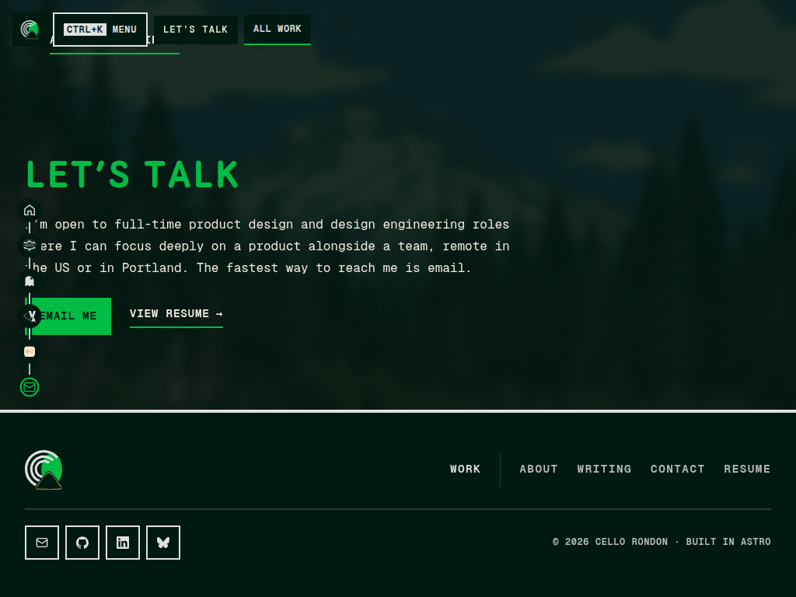
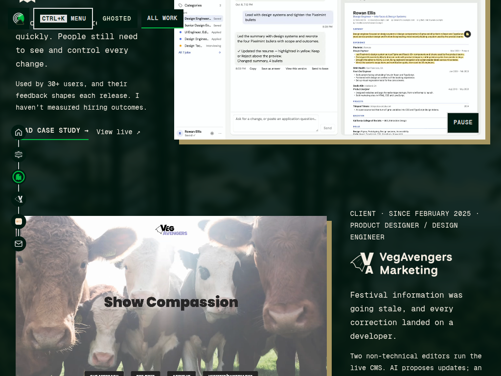
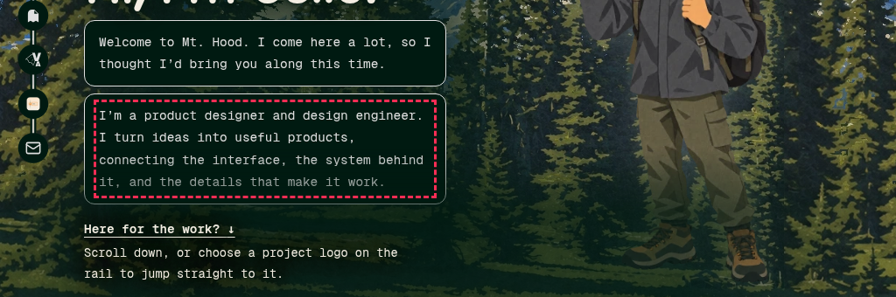
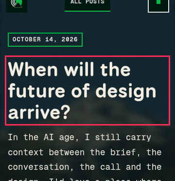

# Screen audit, 2026-11-13

Branch `screen-audit/2026-11-13` from `origin/master` `1677919`. Research only: nothing in `src/` changed.

**Method.** `pnpm build && pnpm screen:audit` ([`scripts/screen-audit.mjs`](../../scripts/screen-audit.mjs)) loads every page in `dist/` (19 routes: every page, case study and post) at 360, 390, 768, 1024, 1440 and 1920 px in Dusk and Day, with reduced motion and reveals finished. That's **228 screens**. A second pass covered the sizes laptops and turned phones actually have: 1280×720, 1366×768, 1180×820 and 844×390 (**152 screens**). On each screen it flags:

- text cut off by an `overflow: hidden`/`clip` box, an ellipsis or a line clamp
- text **covered** by something opaque painted over it (the fixed rail, a bar, an image, a scrim). First-screen text is tested at the top of the page; everything else is tested scrolled to the middle of the screen, where a reader meets it.
- text or elements past the side of the screen, and sideways page scroll
- text spilling out of its own box, and content wider than a non-scrolling text component
- headings that break mid-word or leave one word on the last line
- text drawn faded by a mask or low opacity
- tap targets under 44 px at 1024 and below (links inside running text are exempt)

Each finding gets a screenshot with its surroundings and an outline, and duplicates are grouped by element so one cause shows up once. Every P1 and P2 group below was checked by eye, and the rail finding was reproduced with real wheel scrolling (shots 01–02). Three false positives turned up along the way and the checks now skip them: a frame's offset decoration counted as overflow, a transparent stretched card link counted as a cover, and text inside a closed `
`.

**Result.** **No text is clipped by a box, truncated, off-screen or causing sideways scroll on any page, at any size, in either theme.** The cut-off titles are on the **home page from 1024 to 1440 px**, where two things are **painted over** the text, so an overflow check alone misses them. Both have one cause each, so two small CSS changes fix all 6 P1 groups.

| | Groups | Instances |
|---|---:|---:|
| P1 cut off / covered | 6 (2 causes) | home only, 1024–1440 px plus 1180, 1280 and 1366 |
| P2 visibly wrong | 2 (1 cause) | 3 page titles on phones |
| P3 polish | 25 (3 causes) | 9 orphan groups, 15 tap-target groups, 1 faded label |

Re-run after a ship: `pnpm screen:audit .screen-audit/after --baseline .screen-audit/<earlier>/findings.json` prints which groups are new and which are fixed. `--base <deploy preview URL> --pages /,/about/` audits a Netlify preview instead of `dist/`.

---

## Ranked findings

### P1-A · The chapter rail covers the start of home-page copy (1024–1440 px)

| Where | Width/theme | What's covered |
|---|---|---|
| `/` Ghosted row: `p.work-role`, `div.work-copy p`, `p.work-outcome`, the "Read case study" link | 1024, 1180, 1280, 1366, 1440 · both | the first 1–3 characters: "MY PRODUCT" reads "Y PRODUCT" ([03](screen-audit-2026-11-13/03-rail-work-role-1024.png), [04](screen-audit-2026-11-13/04-rail-work-role-1440.png)) |
| `/` Let's Talk: `h2.section-title`, `p.section-intro`, the Email me button | 1024, 1180 · both | "LET'S TALK" reads "ET'S TALK", "I'm open" reads "'m open" |

- **Cause (component):** `ChapterRail.astro` is `position: fixed; left: var(--space-16)` with 44 px stops scaled ×1.15, so it covers roughly x = 13–66 px from 900 px up. The home sections use `padding-inline: var(--layout-gutter)` (max 2 rem = 32 px), so any row whose copy sits on the left starts under the rail. The Ghosted row puts its copy on the left. At 1920 the centred container clears it.
- **Fix:** add a layout token such as `--rail-clearance: calc(var(--space-16) + var(--touch-target) * 1.15 + var(--space-16))` (≈ 83 px). On pages with the rail, from 900 px up, start the content at `padding-inline-start: max(var(--layout-gutter), var(--rail-clearance))` (`html:has(.chapter-rail) main .container`, or the home `.work`/contact containers). One rule, home only. Re-run `pnpm screen:audit --pages /` and expect 0 covered.

### P1-B · The hero links' scrim dims the last line of the second greeting bubble (1024 px and up)

- **Where:** `/`, `span.message-copy` in the second `.hero-bubble`, at 1024, 1180, 1280, 1366, 1440 and 1920, in both themes, on first load. This is the first screen every visitor sees.
- **Cause (component):** `.hero-routes` is `z-index: 3` and is also a `.copy-scrim`. Its feathered `::before` reaches 45% above the links (`.hero-routes::before { inset: -45% -8% -12% -25% }`, `index.astro:253`) and paints semi-opaque ink over the bottom of `.hero-bubbles`, which sits lower in the stack.
- **Fix:** put the bubbles above the routes' scrim (`.hero-bubbles { position: relative; z-index: 4 }`), or pull the scrim's top inset in at desktop as the phone rule already does (`-25%`). The first is simpler and keeps the feather on the art.

### P2 · Page titles end on one word on phones

- `h1.read-title` on two posts at 360, 390 and 768: "…of design / **arrive?**"; `/design-system` h1 at 390: "BUILT FROM ONE / **FILE**" ([07](screen-audit-2026-11-13/07-orphan-ds-hero-390.png)).
- **Cause (token/global):** headings have no `text-wrap` rule. Only `Hero.astro` and `card.astro` set `balance`; `Layout.astro`'s global `h1, h2` block doesn't.
- **Fix:** see Batch B. The same rule fixes the 9 P3 orphan groups below.

### P3 · One-word last lines in section and card headings (9 groups, same cause as P2)

Home "SELECTED CASE / **STUDIES**" at 360–390 ([08](screen-audit-2026-11-13/08-orphan-home-section-390.png)); post and case-study `.prose h2`/`h3` such as "WHAT WOULD HAPPEN TO HER / **WORK?**" ([09](screen-audit-2026-11-13/09-orphan-prose-h2-390.png)); the Writing card title "…redesign / **them**"; résumé role "PRODUCT DESIGN LEAD / DESIGN / **ENGINEER**" ([10](screen-audit-2026-11-13/10-orphan-resume-role-360.png)); four `/design-system` section titles; and "A PROJECT CHANNEL WHERE THE WORK IS / **HAPPENING**" at 844–1366.

**Fix:** `h1, h2, h3, h4 { text-wrap: balance; }` in `Layout.astro`'s global heading block, plus `.card-title` and `.job-info h4`. This changes line breaks on almost every page at some width, so `ui:shots` will show diffs. That's the intended change, and Cello should see the before and after.

### P3 · Tap targets under 44 px on phones and tablets (15 groups, 3 components)

| Component | Size | Pages |
|---|---|---|
| Footer nav, utility links and socials (`Layout.astro` footer) | 40×43, 50×43, 40×40 | every page ([11](screen-audit-2026-11-13/11-targets-footer-390.png)) |
| `ArrowLink` ("READ CASE STUDY →", "ALL CASE STUDIES →", "VIEW RESUME →") | ~150×30 | 12 pages ([12](screen-audit-2026-11-13/12-targets-arrow-link-390.png)) |
| Scene bar `a.bar-allwork`, `a.bar-link`, header `a.nav-link` at 1024 | 86×39, 63×39, 74×34 | 10 pages |
| Case-study table of contents `nav.read-toc a` | 330×30 | 4 case studies ([13](screen-audit-2026-11-13/13-targets-toc-360.png)) |
| One-offs: home "View live ↗" (90×24), the first hero link (358×25), `/card` "Direct contact file" (160×23) | | 2 pages |

All of them pass WCAG 2.2's 24 px minimum (2.5.8). 44 px is the site's own `--touch-target` token, and the rail and theme buttons already meet it. **Fix:** `min-height: var(--touch-target)` with `display: inline-flex; align-items: center` on `ArrowLink`, the footer links and the bar links, and a taller `padding-block` on TOC links. These are component-level changes, so nothing is done page by page.

### P3 · "Last updated" drawn at 70% opacity

`/privacy` and `/terms` `p.legal-updated` uses `opacity: .7` ([14](screen-audit-2026-11-13/14-faded-legal-updated-360.png)). It's readable, but it's the only text on the site dimmed with opacity instead of a role. **Fix:** `color: var(--text-muted)`, no opacity.

---

## Fix batches (proposed, nothing changed)

| Batch | Fixes | Files | Risk | Size |
|---|---|---|---|---|
| **A · Uncover the home page** | P1-A rail clearance, P1-B bubble above the scrim | `tokens.json` (one layout token), `pages/index.astro` (or `scene.css`) | Home only; screens ≥900 px shift right by about 50 px where copy sat under the rail | S |
| **B · Balanced headings** | P2 + 9 P3 orphan groups | `Layout.astro` global headings, `BlogCard`/`ProjectCard` title, résumé role | Line breaks change site-wide (a design call) | S |
| **C · 44 px targets** | 15 tap-target groups | `ArrowLink.astro`, `Layout.astro` footer, `ContextBar.astro`, the case-study TOC, the home hero links | Footer and links grow a few px; check the footer row at 390 | M |
| **D · Small cleanups** | legal "Last updated" opacity | `LegalPage.astro` | none | XS |

Each batch ships through `docs/ship/PROFILE.md`: PR preview, `pnpm screen:audit --base <preview> --baseline` showing its groups gone and none new, Cello's go, then fast-forward master.

---

## Could be even better (recommendations to pick from)

These aren't bugs. They're places where the screens could look more deliberate. Pick any; none is started.

1. **Give the reading bar one plate.** Once you scroll, the top-left bar is three separate pills (Menu, the current chapter, All work), and the copy scrolling underneath shows through the gaps between them (shot 02, top left). One continuous plate, or a short top scrim behind the row, would read as a single instrument.
2. **Square up the desktop page nav.** On scene pages the right-hand nav is a stack of pills with different widths (About, Writing, Design system, Resume), so the column is ragged on the left ([15](screen-audit-2026-11-13/15-polish-home-1440.png)). Equal-width pills, or one plate with a list, would match the poster's hard edges.
3. **Split the long role eyebrow on cards.** "CLIENT · SINCE JANUARY 2022 · PRODUCT DESIGN LEAD / DESIGN ENGINEER" runs to two or three lines above the title on phones, so the eyebrow is longer than the title it labels ([16](screen-audit-2026-11-13/16-polish-projects-390.png)). Engagement on one line and role on the next, or the role only on phones, keeps the title as the first thing you read.
4. **Footer nav on phones.** WORK sits alone on the first line, with About, Writing and Contact on the next ([11](screen-audit-2026-11-13/11-targets-footer-390.png)). The desktop divider layout doesn't survive the wrap. A two-column grid on phones would look intended.
5. **Make the audit part of shipping.** Add `pnpm screen:audit --base <preview> --baseline <last master run>` to the ship profile's checks, so a new covered or clipped title fails the preview before it reaches master. Keep the last master `findings.json` as the baseline.
6. **Add a WebKit pass.** This audit ran in Chromium. If the cut-off titles Cello sees are on his iPhone, Safari's font metrics for National Park and Geist Mono can differ. Install Playwright WebKit on the Mac (or `npx playwright install webkit` in WSL) and add a `--browser webkit` flag.

## Not covered

Chromium only, so no Safari or WebKit (see 6). Default state only: menu closed, no hover, no open dialogs. Reduced motion is on, so the greeting's typing and entry animations are seen in their final state. Colour contrast isn't checked here (see `audit.md`). Physical phones weren't used.

**Open question for Cello:** the cut-offs found here are on the home page at laptop widths. If the titles you've seen cut off were somewhere else (a page, or your phone), tell me which page and device and I'll add that case to the script.
